# 🗄️ Отчёт: Индексы в MySQL

> **Дисциплина:** Основы проектирования баз данных
> **Задание:** Изучение индексов, EXPLAIN, составных и покрывающих индексов.
> **Дата:** ноябрь 2026

---

## 📑 Содержание

1. [Цель работы](#-цель-работы)
2. [Среда выполнения](#-среда-выполнения)
3. [Ход выполнения](#-ход-выполнения)
   - [1. Создание БД и таблиц](#1-создание-бд-и-таблиц)
   - [2. Анализ существующих индексов](#2-анализ-существующих-индексов)
   - [3. EXPLAIN до индекса](#3-explain-до-индекса)
   - [4. Создание индекса](#4-создание-индекса)
   - [5. Функция в WHERE ломает индекс](#5-функция-в-where-ломает-индекс)
   - [6. Составной индекс](#6-составной-индекс)
   - [7. Покрывающий индекс](#7-покрывающий-индекс)
   - [8. Дамп и лог](#8-дамп-и-лог)
4. [Вывод](#-вывод)
5. [Приложения](#-приложения)

---

## 🎯 Цель работы

Научиться создавать индексы, читать план выполнения запроса (`EXPLAIN`) и понимать, когда индекс работает, а когда — нет.

---

## 🛠 Среда выполнения

| Компонент | Версия / Значение |
|-----------|-------------------|
| ОС | macOS (Apple Silicon) |
| Терминал | zsh |
| Docker | Docker Desktop |
| Образ MySQL | `mysql:8.0` → **MySQL Community Server 8.0.46** |
| Кодировка | `utf8mb4` / `utf8mb4_unicode_ci` |

---

## 🚀 Ход выполнения

### 1. Создание БД и таблиц
Создана база `index_practice` с таблицами `customers` и `orders`, заполнены тестовыми данными.
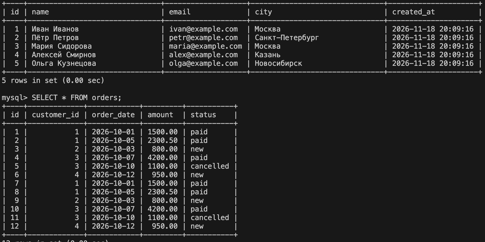

### 2. Анализ существующих индексов
С помощью `SHOW INDEX FROM orders;` выяснено, что по умолчанию есть индексы по первичному ключу (`PRIMARY`) и внешнему ключу (`customer_id`). Индекса по `amount` нет.
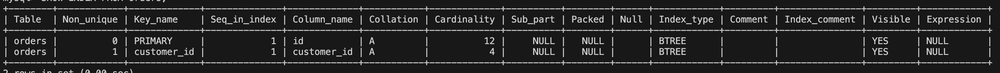

### 3. EXPLAIN до индекса
Запрос `SELECT * FROM orders WHERE amount > 1000;` без индекса выполняется через **full scan** (`type: ALL`).
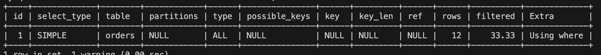

### 4. Создание индекса
Создан индекс `idx_amount`. После этого `EXPLAIN` показывает `type: range` и использование `idx_amount`, количество просматриваемых строк уменьшилось.
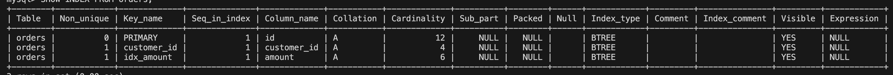
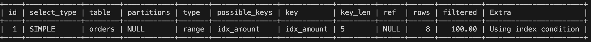

### 5. Функция в WHERE ломает индекс
Запрос `WHERE YEAR(order_date) = 2026` игнорирует индекс (снова `type: ALL`), так как функция применяется к каждой строке.
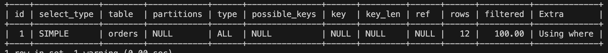

Переписали запрос без функции (`order_date >= '2026-01-01' ...`) и создали индекс `idx_order_date`. 
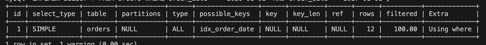
> *Примечание: на данном этапе MySQL всё еще выбирает `type: ALL`, так как таблица содержит всего 12 строк. На больших данных он бы выбрал `range`.*

### 6. Составной индекс
Создан индекс `idx_status_amount (status, amount)`. Он работает для `WHERE status = 'paid'` и для `WHERE status = 'paid' AND amount > 1000`.
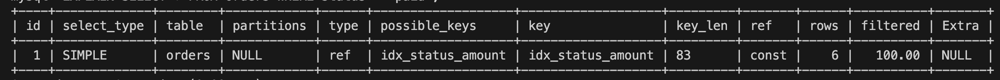
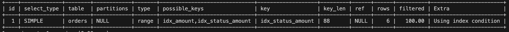

Однако для `WHERE amount > 1000` (без `status`) составной индекс не используется (правило левого префикса).
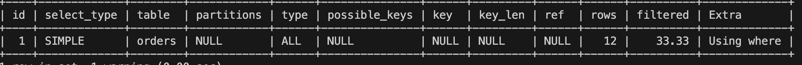

### 7. Покрывающий индекс
Создан индекс `idx_customer_amount (customer_id, amount)`. Запрос с `GROUP BY customer_id` использует `Using index` в `EXPLAIN`, то есть MySQL не обращается к таблице.
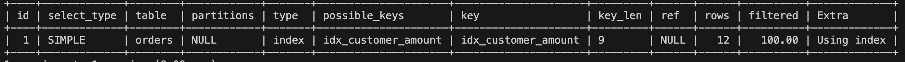

### 8. Дамп и лог
Создан чистый дамп БД (`index_dump.sql`) и отфильтрованный лог действий (`my_actions.log`).
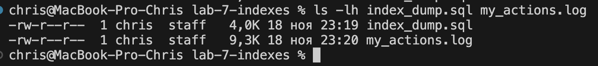
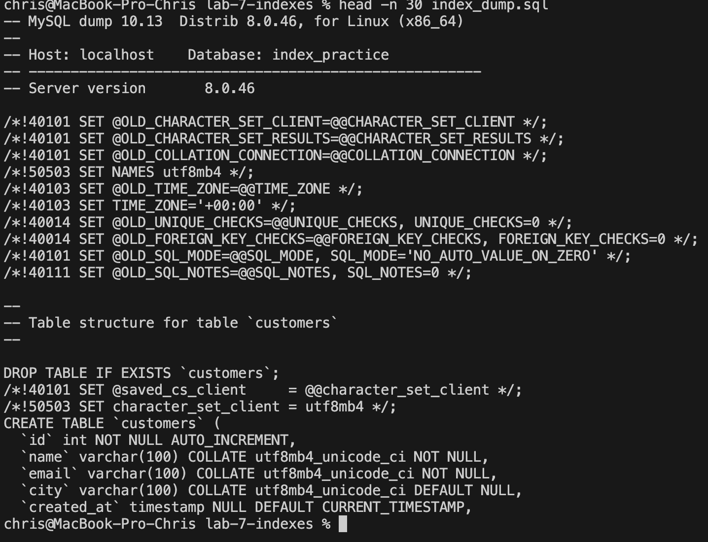
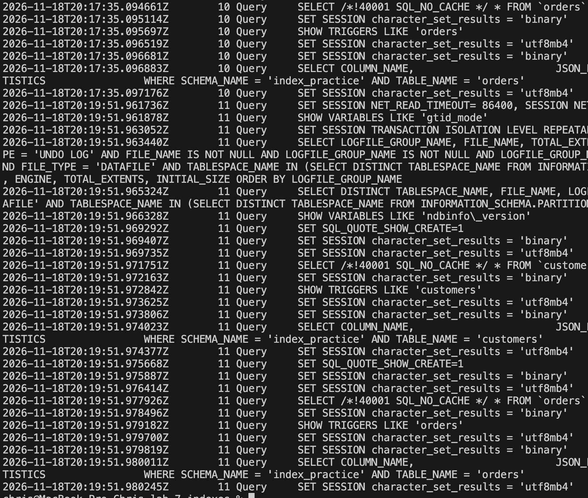

---

## ✅ Вывод

В ходе работы:

1. ✅ Освоен инструмент `EXPLAIN` для анализа плана запроса.
2. ✅ Продемонстрировано, что индексы ускоряют чтение (переход от `type: ALL` к `type: range`).
3. ✅ Доказано, что применение функций в `WHERE` (например, `YEAR()`) ломает использование индекса.
4. ✅ Проверено правило левого префикса для составных индексов.
5. ✅ Изучен покрывающий индекс (`Using index`), который позволяет избежать чтения таблицы.
6. ✅ Сформированы дамп базы данных и лог действий пользователя.

---

## 📎 Приложения

- 💾 [Дамп БД](index_dump.sql)
- 📄 [Лог действий](my_actions.log)

---

  <i>© 2026</i>

